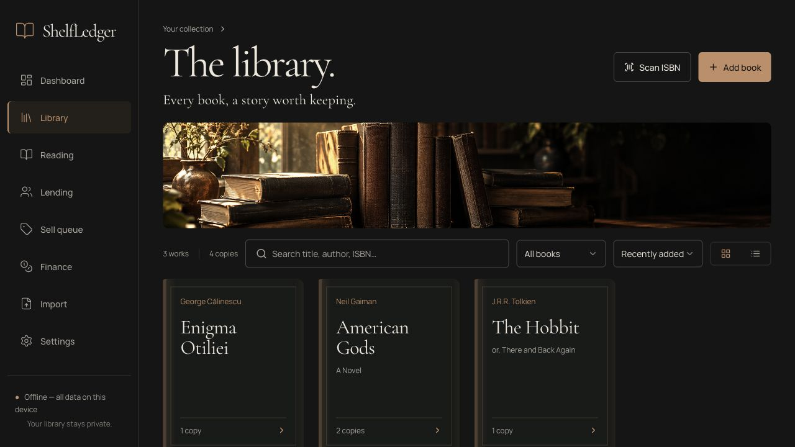
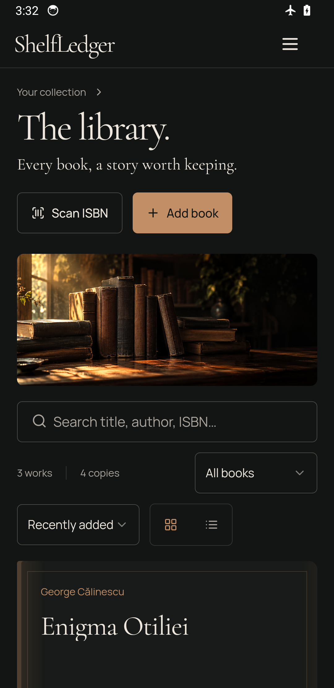
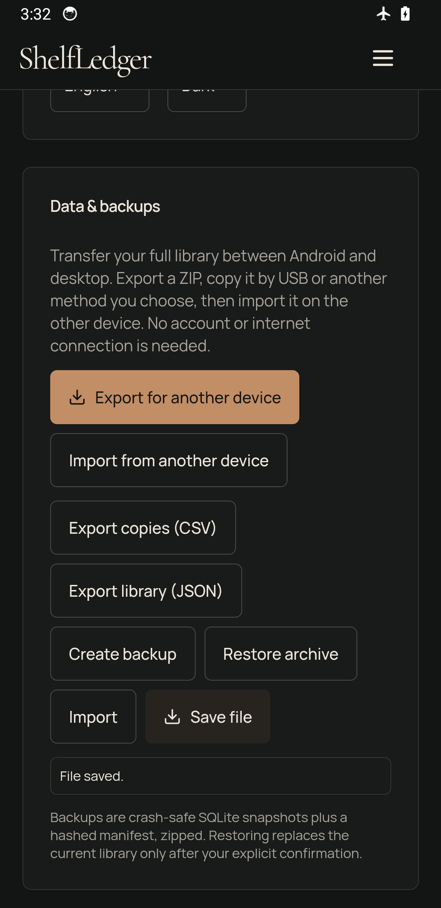
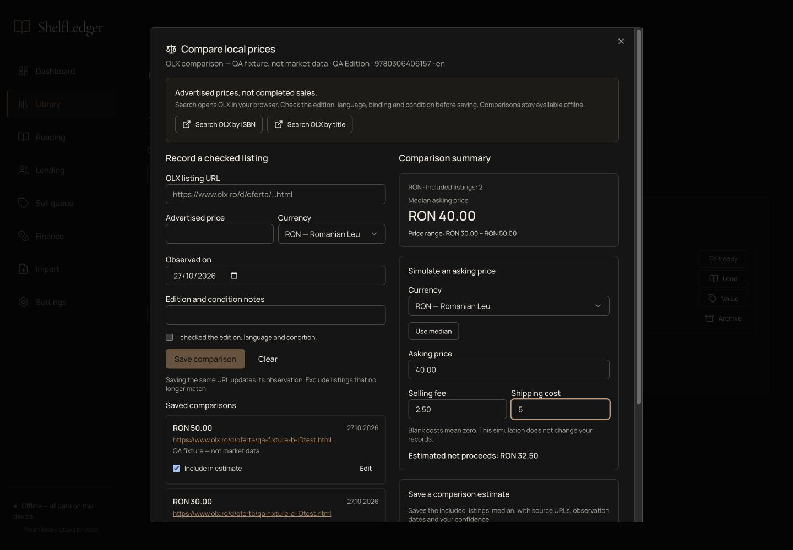
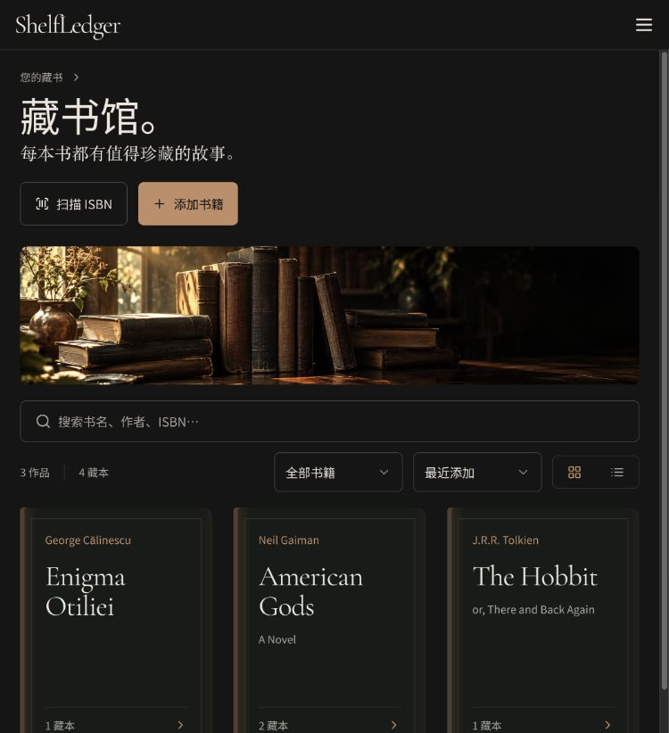
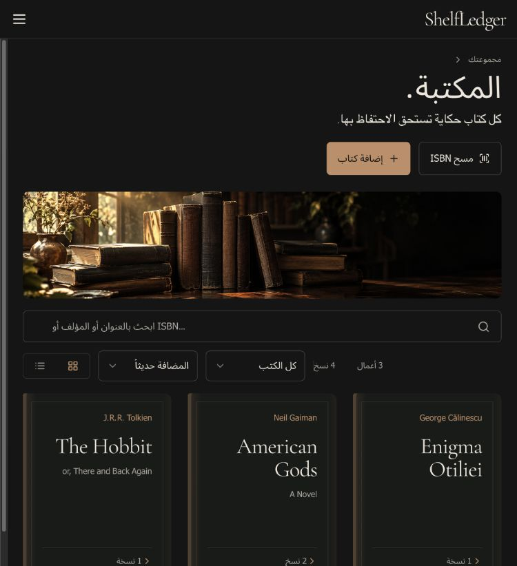
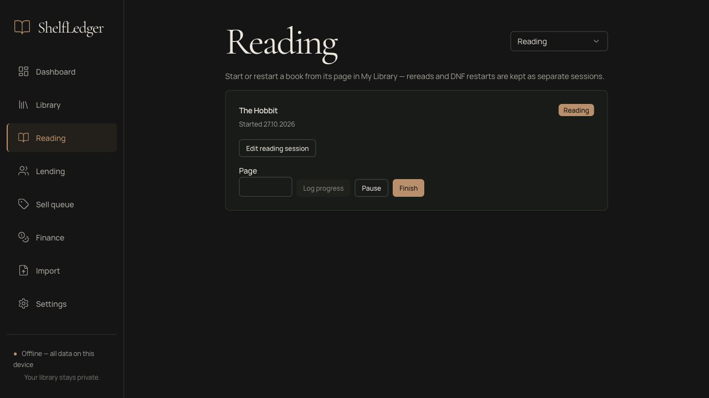
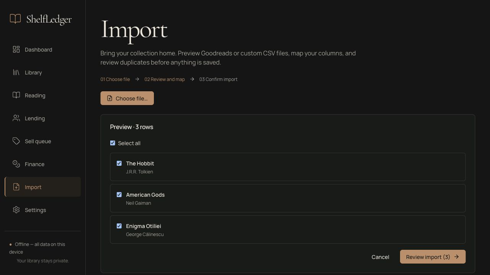

# ShelfLedger

**Every book, a story worth keeping.**

An offline-first, open-source personal library for the books you own and the
stories you read. Catalog editions, manage individual copies, keep a reading
journal, lend to friends, and record the journey from purchase to resale.

Your data stays on your device in a readable SQLite database. No account,
subscription, hosted database, or Docker required.

[Build & run tutorial](docs/tutorial.md) · [Android & device transfer](docs/android.md) · [Features](#what-you-can-do) ·
[Development](#development) · [Privacy](PRIVACY.md) · [MIT license](LICENSE)

## A quieter home for your collection



*Actual app screenshot using the bundled demo library. Light, dark, and system
themes; eleven interface languages (the initial global top ten plus Romanian); grid/table views; responsive browser navigation.*

## What you can do

| Your library | What ShelfLedger keeps track of |
| --- | --- |
| **Catalog your books** | Camera/photo ISBN scanning, manual entry, cached Open Library/Google Books/ISBN Search lookups and Libris book-link import, editable metadata and tags, duplicate detection, and full-text search. |
| **Cloud backups** | Manual Google Drive snapshot sync, conflict review and version history; iCloud/other providers through ZIP file backups. [Google setup and recovery](docs/cloud-sync.md). |
| **Find every copy** | Multiple editions and physical copies, condition, notes, acquisition costs, and a room → bookcase → shelf → box hierarchy. Archive and restore inventory while keeping its history. |
| **Keep a reading journal** | Want-to-read, reading, finished, paused, and DNF sessions; progress, dates, ratings, reviews, and rereads. Reading stays separate from ownership. |
| **Lend with confidence** | Contacts, due dates, returns, and a per-copy loan history. |
| **Compare local offers** | Search OLX Romania by edition ISBN/title, save checked asking prices with sources and dates, compare medians/ranges by currency, simulate net proceeds, and explicitly save an evidenced valuation. [Guide](docs/market-comparisons.md). |
| **Understand your spending** | Purchase costs, sourced manual estimates, asking prices, and realized sales recorded separately. Integer minor units and ISO currency codes; currencies are never summed together. |
| **Use your language and currency** | English, Simplified Chinese, Hindi, Spanish, Arabic, French, Bengali, Portuguese, Indonesian, Urdu, and Romanian. All 165 current ISO currencies/fund units with defined minor units, localized names and exact 0–4 decimal handling. Arabic/Urdu use right-to-left layouts. |
| **Bring your collection along** | Goodreads/custom CSV mapping, preview, duplicate policies, row selection, confirmation, and import logs. |
| **Keep control of your data** | CSV/JSON exports, consistent SQLite backups, transactional restore, and separately restored libraries you can switch between. Transfer the complete library by ZIP between Android and Windows/macOS/Linux without an account or internet. |

### Take your library offline on Android

The Android app shares the desktop library and domain model, with touch-sized
controls and native file pickers. Books, reading, loans, finances, barcode
decoding, translations and backup/restore stay on the device. Internet access is
used for explicit update checks and optional Google Drive sync; the library works
offline. Uncached ISBN metadata requires manual entry on Android.

Use **Settings → Data → Export for another device**, copy the ZIP by USB, then
**Import from another device** on the receiver. Restore requires confirmation;
transfers are manual snapshots.

On desktop and Android, **Settings → About ShelfLedger** shows the installed
version. **Check for updates** checks the latest stable GitHub release only when
pressed, then offers its download page. Updates are downloaded and installed
manually. See [Android installation, build and transfer](docs/android.md).

| Android collection, in airplane mode | Native device-transfer controls |
| --- | --- |
|  |  |

### Compare local asking prices



*Actual app screenshot using a disposable QA library. The sample listings and
amounts are test fixtures, not fetched market data. [How to compare a book](docs/market-comparisons.md).*

### Your language, your collection

| Simplified Chinese | Arabic with right-to-left layout |
| --- | --- |
|  |  |

All eleven language bundles and script fonts work offline. See the
[localization guide](docs/localization.md) for coverage, compatibility, and how
to add another language or update the currency catalog. Native-speaker editorial
review remains outstanding.

### Read, record, return



Start a session from a book's detail page, log your progress, and keep each reread
as a separate chapter in your history.

### Preview before importing



Review selected rows before saving. Custom CSV files support column mapping, and
duplicates have explicit policies. See [the tutorial](docs/tutorial.md#import-a-collection)
for the walkthrough and [import formats](docs/import-format.md) for the data contract.

### Scan when you choose

Select **Scan ISBN** in the library and allow camera access when your browser or
operating system requests it. Live scanning requires permission; photo scanning
and manual ISBN entry remain available if access is unavailable or denied.
Camera frames are processed on your device. Metadata lookup is a separate,
user-initiated request. ISBN lookup tries Open Library, Google Books, then ISBN Search. If a
Romanian edition is missing, paste its Libris product link in **Add book** and
choose **Import from Libris**. Review the details before saving. Cached results
work offline; Android only uses transferred caches and manual entry.
See [metadata lookup](docs/metadata.md) for coverage and provider limits.

Open a book and use the edition's **Fetch cover**, **Choose cover photo**, or
**Photograph cover** controls. Review a camera capture before **Save photo**.
Saved covers appear in the library and remain available offline. Full JSON and
ZIP exports include them for transfer to another device. Android uses photos or
transferred covers; online cover fetching is desktop/web only.
See [cover images](docs/covers.md).


*The banner and still life are generated decorative artwork. App screenshots are
unmodified captures of the working browser and Android versions using disposable demo data.
See [image provenance and prompts](docs/images/README.md).*

## Built around your books

A literary **work**, a published **edition**, and each physical **copy** are
separate objects. Reading status, ownership status, and loan records stay
separate, so finishing a book never changes who owns it.

Important interactions work offline. Network metadata is optional, cached, and
falls back to manual entry. ShelfLedger never invents metadata, prices,
valuations, or exchange rates.

## Project status

Catalog, reading, loans, resale/finance, import/export/restore, and the cinematic
redesign are implemented. A local macOS app bundle builds with the camera usage
description and entitlement; its ad-hoc signature verifies. Windows and Linux
are targeted through Tauri 2 but have not been executed in the latest local
verification. The optional browser version uses the same Rust core over loopback
HTTP; it is not a hosted cloud service.

Verified on **27.10.2026**: **99 Rust tests** and **290 frontend tests** pass, along
with strict TypeScript/production build, Rust formatting, and Clippy with warnings
denied. Browser checks cover imports, profile switching, reading, lending,
editing, all eleven language choices, preference persistence, currency selection,
OLX comparisons, saved evidence and desktop/mobile layouts. A separate local check imports a supplied 209-row
Goodreads export without row errors and verifies idempotent repeat import; see
[import verification](docs/import-format.md#verification-with-the-supplied-export--27102026).

The audit remediation addresses **23 of 24 findings**. Two upstream Rust advisory
warnings remain visible. Physical webcam/OS consent, clean-machine installation,
Windows/Linux execution, minimum-toolchain CI, and Developer ID signing/notarization
remain release checks. See the [audit record](docs/audit-remediation.md) and
[release checklist](docs/release.md).

Phase 6 remains deferred: receipts/OCR, general attachment-byte portability, ebooks/devices,
automatic marketplace collection, and optional encrypted sync. Current snapshots preserve
cover images as well as attachment records/relative paths; other attachment files remain deferred.

## Development

Prerequisites: [Node.js ≥ 22.12](https://nodejs.org), [pnpm 12.15](https://pnpm.io),
[Rust ≥ 1.90](https://rustup.rs), plus the [Tauri 2 prerequisites](https://tauri.app/start/prerequisites/)
for your OS.

```sh
pnpm install --frozen-lockfile
pnpm tauri dev       # desktop development
pnpm test:rust       # Rust unit/integration tests
pnpm test:web        # frontend tests
pnpm lint            # typecheck + production frontend build
```

Run the browser version from a production frontend build:

```sh
pnpm build
pnpm web:server      # open http://127.0.0.1:8787
```

For browser UI development, keep `pnpm web:server` running in one terminal and
run `pnpm dev` in another. Open the Vite URL printed in that second terminal;
Vite proxies `/api` to the local core.

For native bundles:

```sh
pnpm tauri build
```

The [step-by-step tutorial](docs/tutorial.md) covers prerequisites, desktop and
browser setup, bundle output paths, first use, backups, and troubleshooting.

### Releases

GitHub Actions prepares a release PR with synchronized versions and categorized
Features/Fixes/Changes notes from Conventional Commits. Merge it to build macOS
(Apple Silicon and Intel), Windows x64 and Linux x64 installers, then publish a
GitHub release with download links and SHA-256 checksums after every build passes.
See the [release guide](docs/release.md) for enabling the workflow, signing
secrets and retrying failed builds. macOS defaults to ad-hoc signing unless Apple
credentials are configured; Windows installers are currently unsigned.

### Stack

Tauri 2 and Rust · React and strict TypeScript · Vite · Tailwind CSS and shadcn/ui ·
TanStack Query/Table · SQLite through SQLx, with migrations, foreign keys, WAL,
and FTS5 full-text search.

## Documentation

- [Tutorial: build, run, and use ShelfLedger](docs/tutorial.md)
- [Architecture](docs/architecture.md) — boundaries, stack, and transport
- [Database](docs/database.md) — schema, invariants, money, and dates
- [Design](docs/design.md) — visual system, workflows, and accessibility
- [Implementation roadmap](docs/implementation.md) — phase status and deferred work
- [Languages and currencies](docs/localization.md) — coverage, upgrades, and extension
- [Import formats](docs/import-format.md) — CSV mapping and JSON snapshots
- [Web version](docs/web.md) — loopback server and browser setup
- [Release automation](docs/release.md) — versions, notes, downloads, signing, and retries
- [Audit remediation](docs/audit-remediation.md) — findings, fixes, and evidence
- [Architecture decisions](docs/decisions/) — rationale behind the model and stack
- [Privacy](PRIVACY.md) — local processing and optional network requests
- [Sample library](demo/demo-library.json) — demo data to import via Settings

## License

[MIT](LICENSE). Third-party metadata and cover images remain subject to their own
terms. The generated README artwork is decorative; it does not represent actual
catalog records or redistributed book covers.
