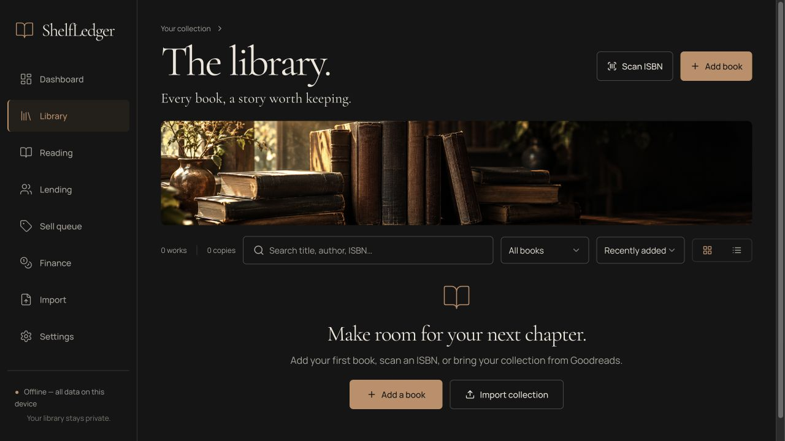
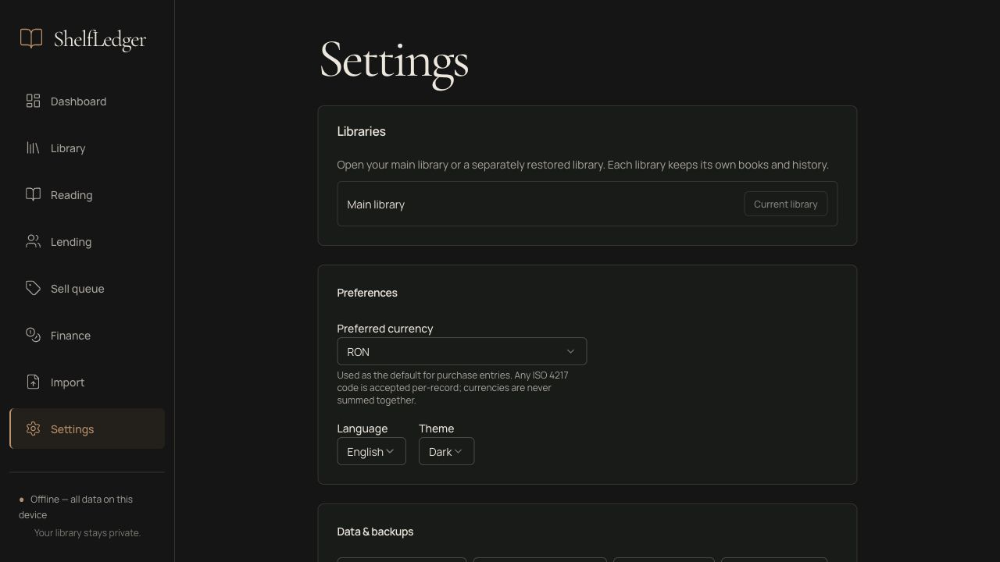
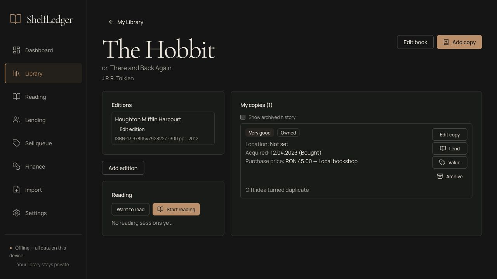

# ShelfLedger tutorial: build, run, and use the app

This guide takes you from a fresh checkout to a local library. Choose the desktop
app or the browser version; both use the same Rust domain logic. Screenshots use
the bundled demo dataset in a disposable local browser library, not personal data.

## 1. Install prerequisites

Install these before running the project:

| Requirement | Version or setup |
| --- | --- |
| Git | To clone the repository. |
| Node.js | 22.12 or newer; see [Node.js downloads](https://nodejs.org/en/download). |
| pnpm | 12.15.0, matching `package.json`; see [pnpm installation](https://pnpm.io/installation). |
| Rust and Cargo | Rust 1.90 or newer; see [rustup](https://rustup.rs). |
| Native build dependencies | Follow [Tauri 2 prerequisites](https://tauri.app/start/prerequisites/) for your OS. macOS needs Apple's command-line development tools; Windows needs the C++ build tools and WebView2; Linux needs its distribution's build/WebKitGTK packages. |

Check the installed tools:

```sh
node --version
pnpm --version
rustc --version
cargo --version
```

The latest local verification used Node 24.22 and Rust 1.99.1 on macOS. The minimum
Rust job and Windows/Linux jobs are configured in CI; that is separate from local
verification. An internet connection is needed to download dependencies initially.
Normal catalog, reading, and inventory use works offline afterward.

## 2. Get the source

```sh
git clone https://github.com/dkvlabs/ShelfLedger.git
cd ShelfLedger
pnpm install --frozen-lockfile
```

Run all following commands from the repository root unless a step says otherwise.
The first Rust build downloads crates and takes longer than later builds.

## 3. Run the desktop app

```sh
pnpm tauri dev
```

This starts Vite and opens the native ShelfLedger window. Leave the terminal
running while developing. Frontend changes reload automatically. Quit the app
and stop the development process with Ctrl+C when finished.

The desktop library lives in the OS application-data directory selected by
Tauri, using the configured bundle identifier `io.github.shelfledger.app`.
It is not stored in the source checkout. The browser version has a separate
local data directory by default.



## 4. Run the browser version

### Use the built frontend

```sh
pnpm build
pnpm web:server
```

Open [http://127.0.0.1:8787](http://127.0.0.1:8787). Keep the server terminal open;
Ctrl+C stops it. The UI is served from `dist/`, and data is stored in
`shelfledger-data/` relative to the current working directory. That data directory
is ignored by Git. Keep it when updating or rebuilding the app.

### Develop the browser UI

Start the backend in terminal 1:

```sh
pnpm web:server
```

Start the frontend in terminal 2:

```sh
pnpm dev
```

Open the Vite URL printed in terminal 2 (configured port 1420). Vite proxies
`/api` to the local Rust server on port 8787. Opening Vite without the Rust server
starts the UI but leaves data operations unavailable.

### Choose another port or data directory

These optional environment variables are read when the server starts:

| Variable | Default | Purpose |
| --- | --- | --- |
| `SHELFLEDGER_DATA_DIR` | `./shelfledger-data` | Library database, uploads, exports, and backups. |
| `SHELFLEDGER_WEB_DIST` | `./dist` when present | Directory containing the built frontend. |
| `SHELFLEDGER_WEB_PORT` | `8787` | Loopback server port. |

Example for macOS/Linux shells:

```sh
SHELFLEDGER_WEB_PORT=8789 pnpm web:server
```

Equivalent in Windows PowerShell:

```powershell
$env:SHELFLEDGER_WEB_PORT = "8789"
pnpm web:server
```

Then open `http://127.0.0.1:8789`. The Vite development proxy continues to target
8787, so use the default backend port for the two-terminal development setup.
The server binds only to your own machine. For data-directory sharing and request
protection details, read [the web guide](web.md). Use one running frontend when
restoring or switching libraries.

## 5. Build a native application

```sh
pnpm tauri build
```

The configured build runs the production frontend build and compiles the native
app. Bundles are written under `src-tauri/target/release/bundle/`; generated
formats depend on the current OS and installed prerequisites. Build each
platform's native bundles on that platform.

For a macOS `.app` without also requesting a DMG:

```sh
pnpm tauri build --bundles app
open src-tauri/target/release/bundle/macos/ShelfLedger.app
```

That macOS app bundle has been built and its signature verified locally. It uses
ad-hoc signing to include the camera entitlement. Public distribution needs
Developer ID signing and notarization; see [the release checklist](release.md).
Windows/Linux installer execution and clean-machine installation remain release
checks. Tauri's [distribution guide](https://tauri.app/distribute/) documents the
platform-specific bundle options.

## 6. Set your preferences

Open **Settings**. Choose a preferred currency, one of the eleven interface languages, and a light,
dark, or system theme. Arabic and Urdu mirror the interface from right to left.
Currency selectors include all 165 current ISO currencies/fund units with defined
minor units; type a code while the selector is open to jump to it. The currency is a default for new entries; existing records
keep their own currencies and reports never combine different currencies.
See the [language and currency guide](localization.md) for the full language list,
amount precision, old-library upgrades and adding future languages.

Under **Physical locations**, add a room, then a bookcase inside it, then a shelf
inside that bookcase. Choose the parent using **Inside**. You can assign a location
when adding or editing a physical copy.



## 7. Add your first book

1. Open **Library** and choose **Add book**.
2. Enter an ISBN and choose **Look up** if you want to fetch metadata from Open
   Library. You can also enter the title and authors manually without an ISBN.
3. Review the metadata. Separate multiple authors with semicolons.
4. Keep **I own a copy** checked to record a physical item, or uncheck it for a
   wishlist/tracking-only entry.
5. For an owned copy, fill in condition, location, acquisition date, and optional
   purchase price/currency. Leave unknown amounts empty.
6. Choose **Save book**. Review any duplicate warning before adding another copy.

The title/authors describe the work. ISBN/publisher/pages describe its edition.
Condition/location/acquisition describe the particular copy. Use **Add copy** for
another physical item, and **Add edition** for another published version.

Open a book card to use **Edit book**, **Edit edition**, or **Edit copy**. Search
by title, author, ISBN, notes, tags, or location. Library controls also offer
filtering, sorting, and grid/table views.



### Scan an ISBN

Choose **Scan ISBN** in the library, or the scan action beside the ISBN field.
Allow video access when the browser or OS asks. Align a book barcode in the
scanner; decoded ISBNs are checksum-validated.

If permission is denied, enable the camera in browser site permissions or OS
camera privacy settings, then choose **Retry camera**. On macOS, check **System
Settings → Privacy & Security → Camera** and restart the app if needed. An older
installed app must be rebuilt to gain the camera purpose/entitlement declarations.

If the webview does not expose camera capture, use **Scan from photo** or type the
ISBN manually. USB/Bluetooth barcode scanners can type into the ISBN field like a
keyboard. Camera images are processed locally, and closing the scanner releases
capture. Physical camera consent still needs a real-device check for each release.

## 8. Track reading

1. Open a book in **Library** and choose **Want to read** or **Start reading**.
2. Open **Reading** and select the relevant status filter.
3. For an active session, enter the current page and choose **Log progress**.
4. Use **Pause**, **Resume reading**, or **Finish** as appropriate.
5. Use **Edit reading session** to change status, dates, rating, or review. You can
   also clear dates or other optional values when correcting a record.

Start a later reread from the book's page after closing the previous active
session. Previous sessions remain in history. Reading never changes ownership.


## 9. Lend, value, or dispose of a copy

Open a book and find the correct physical copy. **Lend** lets you select an
existing contact or create a new reader and set a due date. Use **Lending** to
review loans and **Record return** when a copy comes back. A lent copy cannot be
lent again or sold before it is returned.

**Value** records a manual observation with its source, date, and confidence;
it does not fetch a market price. **Sell queue** offers explicit decisions and
listing/disposal actions, and **Finance** reports amounts by currency. Record the
actual outcome when a copy is sold, donated, traded, or lost. Purchase cost,
estimate, asking price, and realized sale are separate values.

**Archive** hides a copy without erasing its history. Enable **Show archived
history** in the book's detail page and use **Restore archived copy** to show it
again. Archiving is separate from recording a sale or donation.

## Import a collection

1. Open **Settings → Import**, or **Import → Choose file…**.
2. To try the app, choose `demo/demo-library.json` from this checkout. A fresh
   library imports three works and four physical copies. These are illustrative
   demo records, including sample costs, not fetched prices or valuations.
3. For Goodreads/custom CSV, inspect the preview and adjust column mapping if
   needed. If mappings change, refresh the preview before continuing.
4. Select the rows to import and inspect duplicate policies where offered. The
   default skip policy avoids reimporting an existing work.
5. Choose **Review import**, then **Confirm import** to write the selected rows.
6. Read the result counts and expand **Row log** for skipped rows or errors.

Preview and cancellation do not write library records. JSON snapshots exported
by ShelfLedger include the full supported record history; older/demo JSON is
also accepted. The demo's Enigma Otiliei edition intentionally has no ISBN rather
than carrying an invalid or guessed identifier. See [import formats](import-format.md)
for supported fields, duplicate behavior, and snapshot limitations.


## Back up, restore, and switch libraries

In **Settings → Data & backups**:

- **Export copies (CSV)** produces a copy-oriented spreadsheet export.
- **Export library (JSON)** exports the supported logical records and history.
- **Create backup** creates a consistent SQLite snapshot archive with a hashed
  manifest. Keep a copy outside the app's data directory for independent recovery.
- **Restore archive** opens a review step. **Replace current library** restores
  into the current library after confirmation and first creates a safety archive.
  **Restore as separate library** creates another selectable library.

In the browser version, use the displayed **Download** action to save a generated
file through the browser. In the desktop version, the UI displays the generated
path inside the app-data directory. Under **Libraries**, choose **Open library**
to switch between the main library and separately restored libraries. Changes
are saved per library. Replacement restore does not require a restart.

Attachment records/relative paths are preserved, but attachment bytes and receipt
archives are not yet portable. Receipts/OCR, ebooks, and optional encrypted sync
remain deferred. Do not delete your data directory when updating the app.

## Run checks before contributing

From the repository root:

```sh
pnpm test:web
pnpm test:rust
pnpm lint
cargo fmt --manifest-path src-tauri/Cargo.toml --check
cargo clippy --manifest-path src-tauri/Cargo.toml --all-targets -- -D warnings
```

These checks passed locally with 59 frontend and 88 Rust tests on 27.10.2026.
`pnpm lint` currently runs strict TypeScript checking and the production frontend
build. The complete finding register and remaining upstream dependency warnings
are in [audit remediation](audit-remediation.md).

## Troubleshooting

| Symptom | Next step |
| --- | --- |
| `pnpm` or `cargo` is not found | Finish the prerequisite installation and reopen your terminal so PATH updates apply. |
| Rust/native build fails on system libraries | Install your OS's [Tauri prerequisites](https://tauri.app/start/prerequisites/), then retry from the repository root. |
| Port 1420 or 8787 is already in use | Stop the previous development process. The standalone browser server can use `SHELFLEDGER_WEB_PORT` as shown above. |
| Browser cannot connect | Keep `pnpm web:server` running. Use the printed loopback URL. For the built UI, run `pnpm build` first from the same checkout. |
| UI opens but data operations fail in development | Start the Rust backend on port 8787 as well as Vite. |
| An ISBN is rejected | Check the digits/checksum. Leave it empty for a manual edition rather than guessing an identifier. |
| Metadata lookup is offline or has no match | Continue with manual entry; cached lookups remain available. |
| Camera permission is blocked or capture is unavailable | Follow the scanning steps above, or use photo/manual entry. |
| Import skips a row | Expand the row log, correct invalid values, and review the duplicate policy before retrying. |
| Library looks empty in another app mode | Desktop and browser data directories differ by default. Check the active library in Settings and use export/restore to transfer your records. |

For release acceptance, signing, and real-device camera verification, continue
with [release.md](release.md).
